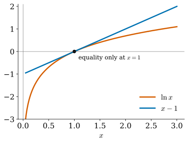

# Likelihood {background-color="#f3f8fc"}



## One coin flip

::: {.intro}
Model: $x\in\{0,1\}$ (tails, heads), $\;P(x\mid\theta) = \theta^x(1-\theta)^{1-x}$
:::

```{ojs}
{
  let th = 0.3, x = "heads";
  const out = html`<div class="wplots"></div>`;
  const TH = grid(0, 1, 201);
  const draw = () => {
    const h = x === "heads", c = h ? COL.A : COL.B;
    const lik = P({width: 640, x: {label: "θ", domain: [0, 1]}, y: {label: null, domain: [0, 1.05]},
      marks: [
        Plot.areaY(TH, {x: d => d, y: d => h ? d : 1 - d, fill: c, fillOpacity: 0.12}),
        Plot.line(TH, {x: d => d, y: d => d, stroke: COL.A, strokeWidth: h ? 5 : 2}),
        Plot.line(TH, {x: d => d, y: d => 1 - d, stroke: COL.B, strokeWidth: h ? 2 : 5}),
        Plot.ruleX([th], {stroke: COL.ink, strokeDasharray: "5,5"}),
        Plot.dot([th], {x: d => d, y: d => d, r: 8, fill: COL.A}),
        Plot.dot([th], {x: d => d, y: d => 1 - d, r: 8, fill: COL.B}),
        Plot.text(["heads (x = 1)"], {x: 0.97, y: 0.86, textAnchor: "end", fill: COL.A, fontSize: 20}),
        Plot.text(["tails (x = 0)"], {x: 0.03, y: 0.86, textAnchor: "start", fill: COL.B, fontSize: 20})
      ]});
    const samp = P({width: 330, x: {label: null, domain: ["tails", "heads"]}, y: {label: null, domain: [0, 1.05]},
      marks: [Plot.barY([{o: "tails", p: 1 - th, c: COL.B}, {o: "heads", p: th, c: COL.A}], {x: "o", y: "p", fill: "c"}), Plot.ruleY([0])]});
    out.replaceChildren(
      fig(`plot of $L(\\theta) = P(x{=}${h ? 1 : 0}\\mid\\theta) = ${h ? "\\theta" : "1-\\theta"}$ against $\\theta$ (area $\\tfrac12$)`, c, lik),
      fig(`plot of $P(x\\mid\\theta{=}${th.toFixed(2)})$ against $x$ (sums to 1)`, COL.ink, samp));
  };
  draw();
  return html`<div class="widget">${row(
    slider({label: "bias of the coin $\\theta$", min: 0, max: 1, step: 0.01, value: th, fmt: v => v.toFixed(2), oninput: v => { th = v; draw(); }}),
    select({label: "observed outcome", options: ["heads", "tails"], value: x, onchange: v => { x = v; draw(); }}))}${out}</div>`;
}
```

::: {.concl}
Fix $\theta$: a distribution over outcomes. Fix $x$: a likelihood, which is not a distribution over $\theta$.
:::

::: {.notes}
Vertical cut: two dots that sum to 1 (sampling distribution). Horizontal reading: a line in θ with area ½, so not a density in θ.
:::

## $n$ coin flips

::: {.intro}
Model: $k$ heads in $n$ independent flips, $\;P(k\mid\theta) = \binom{n}{k}\theta^k(1-\theta)^{n-k}$
:::

```{ojs}
{
  let n = 10, th = 0.3, k = 7;
  const out = html`<div class="wplots"></div>`;
  const TH = grid(0, 1, 201);
  const kSl = slider({label: "observed heads $k$", min: 0, max: n, step: 1, value: k, oninput: v => { k = v; draw(); }});
  const draw = () => {
    const curves = d3.range(n + 1).flatMap(j => TH.map(t => ({j, t, p: binom(j, n, t)})));
    const sel = TH.map(t => ({t, p: binom(k, n, t)}));
    const ymax = Math.max(1.02 * d3.max(curves, d => d.p), 0.3);
    const lik = P({width: 640, x: {label: "θ", domain: [0, 1]}, y: {label: null, domain: [0, ymax]},
      marks: [
        Plot.line(curves, {x: "t", y: "p", z: "j", stroke: COL.grey, strokeOpacity: 0.45, strokeWidth: 1.5}),
        Plot.areaY(sel, {x: "t", y: "p", fill: COL.A, fillOpacity: 0.15}),
        Plot.line(sel, {x: "t", y: "p", stroke: COL.A, strokeWidth: 5}),
        Plot.ruleX([th], {stroke: COL.ink, strokeDasharray: "5,5"}),
        Plot.dot(d3.range(n + 1), {x: () => th, y: j => binom(j, n, th), r: 5, fill: j => j === k ? COL.A : COL.B})]});
    const samp = P({width: 330, x: {label: "number of heads k", type: "band", tickFormat: j => (n <= 12 || j % 2 === 0) ? j : ""},
      y: {label: null, domain: [0, ymax]},
      marks: [Plot.barY(d3.range(n + 1), {x: j => j, y: j => binom(j, n, th), fill: j => j === k ? COL.A : COL.B}), Plot.ruleY([0])]});
    out.replaceChildren(
      fig(`plot of $L(\\theta) = P(k{=}${k}\\mid\\theta)$ against $\\theta$ (grey: other $k$); area $\\frac{1}{n+1}$`, COL.A, lik),
      fig(`plot of $P(k\\mid\\theta{=}${th.toFixed(2)})$ against $k$ (sums to 1)`, COL.ink, samp));
  };
  draw();
  return html`<div class="widget">${row(
    slider({label: "number of flips $n$", min: 1, max: 20, step: 1, value: n, oninput: v => {
      n = v; k = Math.min(k, n); kSl.input.max = n; kSl.set(k); draw(); }}),
    slider({label: "bias $\\theta$", min: 0, max: 1, step: 0.01, value: th, fmt: v => v.toFixed(2), oninput: v => { th = v; draw(); }}),
    kSl)}${out}</div>`;
}
```

::: {.concl}
Same picture with more outcomes: columns sum to 1, rows don't integrate to 1.
:::

::: {.notes}
Grey: one curve per possible k (Bernstein polynomials). Dots on the dashed line are the sampling distribution, shown as bars on the right.
:::

## Normalising the likelihood

::: {.intro}
$\tilde L(\theta) = \dfrac{L(\theta)}{\int_0^1 L(\theta')\,d\theta'}$, with $L(\theta) = P(k\mid\theta)$ from the previous slide
:::

```{ojs}
{
  let n = 10, k = 7;
  const out = html`<div class="wplots"></div>`;
  const TH = grid(0, 1, 201);
  const kSl = slider({label: "observed heads $k$", min: 0, max: n, step: 1, value: k, oninput: v => { k = v; draw(); }});
  const draw = () => {
    const L = TH.map(t => ({t, p: binom(k, n, t)})), N = L.map(d => ({t: d.t, p: (n + 1) * d.p}));
    out.replaceChildren(
      fig(`plot of $L(\\theta)$ against $\\theta$ (area $${(1 / (n + 1)).toFixed(3)}$)`, COL.A, P({width: 560, x: {label: "θ", domain: [0, 1]}, y: {label: null, domain: [0, 1.05 * d3.max(L, d => d.p)]},
        marks: [Plot.areaY(L, {x: "t", y: "p", fill: COL.A, fillOpacity: 0.15}), Plot.line(L, {x: "t", y: "p", stroke: COL.A, strokeWidth: 4})]})),
      fig(`plot of $\\tilde L(\\theta) = \\mathrm{Beta}(${k + 1}, ${n - k + 1})$ against $\\theta$ (area 1)`, COL.C, P({width: 560, x: {label: "θ", domain: [0, 1]}, y: {label: null, domain: [0, 1.05 * d3.max(N, d => d.p)]},
        marks: [Plot.line(L, {x: "t", y: "p", stroke: COL.A, strokeOpacity: 0.4, strokeDasharray: "4,4", strokeWidth: 2}),
                Plot.areaY(N, {x: "t", y: "p", fill: COL.C, fillOpacity: 0.15}), Plot.line(N, {x: "t", y: "p", stroke: COL.C, strokeWidth: 4})]})));
  };
  draw();
  return html`<div class="widget">${row(
    slider({label: "number of flips $n$", min: 1, max: 40, step: 1, value: n, oninput: v => {
      n = v; k = Math.min(k, n); kSl.input.max = n; kSl.set(k); draw(); }}), kSl)}${out}</div>`;
}
```

::: {.concl}
Same shape: only ratios $L(\theta_1)/L(\theta_2)$ carry information.
:::

::: {.notes}
Normalised likelihood = posterior under a flat prior. Only ratios of L mean anything.
:::

## Different priors, same data

::: {.intro}
Hidden bias $\theta^*$. Priors $\mathrm{Beta}(2,6)$ and $\mathrm{Beta}(6,2)$; $\;p(\theta\mid DX) \propto p(\theta\mid X)\,\theta^{h}(1-\theta)^{t}$ after $h$ heads, $t$ tails
:::

```{ojs}
{
  const TH = grid(0.0025, 0.9975, 400), h = TH[1] - TH[0];
  const priors = [{a: 2, b: 6, c: COL.B}, {a: 6, b: 2, c: COL.A}];
  const lp = (a, b) => TH.map(t => (a - 1) * Math.log(t) + (b - 1) * Math.log1p(-t));
  const flip = (st) => +(Math.random() < st.theta);
  const legend = html`<div class="wlegend"></div>`;
  legend.append(T(`plot of $p(\\theta\\mid X)$ (dashed) and $p(\\theta\\mid DX)$ (solid) against $\\theta$`));
  return historyWidget({
    onReset: st => { st.theta = 0.1 + 0.8 * Math.random(); },
    reveal: "reveal true $\\theta$", resetLabel: "new coin",
    buttons: [["heads", () => [1]], ["tails", () => [0]], ["+10 random flips", st => d3.range(10).map(() => flip(st))]],
    render: st => {
      const d = st.obs.slice(0, st.t), H = d3.sum(d), Tl = d.length - H;
      const ll = TH.map(t => H * Math.log(t) + Tl * Math.log1p(-t)), m = d3.max(ll);
      const lik = TH.map((t, i) => ({t, p: Math.exp(ll[i] - m)}));
      const curves = priors.flatMap((p, j) => {
        const pr = normGrid(lp(p.a, p.b), h), po = normGrid(lp(p.a, p.b).map((v, i) => v + ll[i]), h);
        return TH.map((t, i) => ({t, pr: pr[i], po: po[i], j, c: p.c}));
      });
      const truth = st.reveal ? [Plot.ruleX([st.theta], {stroke: COL.ink, strokeWidth: 2, strokeDasharray: "6,4"})] : [];
      const ymax = Math.max(3.5, 1.05 * d3.max(curves, d => d.po));
      return [
        fig(`plot of $\\theta^{${H}}(1-\\theta)^{${Tl}}$ (rescaled to max 1) against $\\theta$`, COL.ink, P({width: 480, x: {label: "θ", domain: [0, 1]}, y: {label: null, domain: [0, 1.05]},
          marks: [Plot.areaY(lik, {x: "t", y: "p", fill: COL.ink, fillOpacity: 0.08}), Plot.line(lik, {x: "t", y: "p", stroke: COL.ink, strokeWidth: 3}), ...truth]})),
        html`<div class="wfig" style="width:640px">${legend}${P({width: 640, x: {label: "θ", domain: [0, 1]}, y: {label: null, domain: [0, ymax]},
          marks: [Plot.line(curves, {x: "t", y: "pr", z: "j", stroke: "c", strokeDasharray: "5,5", strokeOpacity: 0.6, strokeWidth: 2}),
                  Plot.line(curves, {x: "t", y: "po", z: "j", stroke: "c", strokeWidth: 4}), ...truth]})}</div>`
      ];
    }
  });
}
```

::: {.concl}
With enough data the likelihood dominates and the posteriors agree.
:::

::: {.notes}
Hidden bias. Press heads/tails manually, then +10 random a few times. The two posteriors start far apart and merge. Ask for a guess, then reveal. Scrub back to show the early disagreement.
:::

# The exponential distribution {background-color="#fdf5f0"}

## Change of variables

::: {.intro}
Model: $p(x\mid\lambda) = \lambda e^{-\lambda x}$, $x\ge 0$. $\;$ Substitute $z=\log x$: $\;p(z\mid\lambda) = p(x\mid\lambda)\,\dfrac{dx}{dz} = \lambda e^{z}e^{-\lambda e^{z}}$
:::

```{ojs}
{
  let lam = 1;
  const out = html`<div class="wplots" style="flex-wrap:wrap;gap:0 24px"></div>`;
  const X = grid(0, 6, 301), Z = grid(-8, 6, 401);
  const pan = (o) => P({width: 560, height: 190, marginBottom: 40, ...o});
  const two = (f, xs) => [
    Plot.line(xs, {x: d => d, y: d => f(d, 1), stroke: COL.grey, strokeWidth: 2, strokeDasharray: "4,4", clip: true}),
    Plot.line(xs, {x: d => d, y: d => f(d, lam), stroke: COL.B, strokeWidth: 4, clip: true})];
  const pdf = (x, l) => l * Math.exp(-l * x), cdf = (x, l) => 1 - Math.exp(-l * x);
  const pdfz = (z, l) => l * Math.exp(z - l * Math.exp(z)), cdfz = (z, l) => 1 - Math.exp(-l * Math.exp(z));
  const draw = () => out.replaceChildren(
    fig("plot of $p(x\\mid\\lambda)$ against $x$", COL.ink, pan({x: {label: "x", domain: [0, 6]}, y: {label: null, domain: [0, 1.6]}, marks: [...two(pdf, X), Plot.ruleY([0])]})),
    fig("plot of the cdf $1 - e^{-\\lambda x}$ against $x$", COL.ink, pan({x: {label: "x", domain: [0, 6]}, y: {label: null, domain: [0, 1]}, marks: two(cdf, X)})),
    fig("plot of $p(z\\mid\\lambda)$ against $z$", COL.ink, pan({x: {label: "z = log x", domain: [-8, 6]}, y: {label: null, domain: [0, 0.42]}, marks: [...two(pdfz, Z), Plot.ruleY([0])]})),
    fig("plot of the cdf $1 - e^{-\\lambda e^{z}}$ against $z$", COL.ink, pan({x: {label: "z = log x", domain: [-8, 6]}, y: {label: null, domain: [0, 1]}, marks: two(cdfz, Z)})));
  draw();
  return html`<div class="widget">${row(
    logSlider({label: "rate $\\lambda$", min: 0.01, max: 100, value: 1, oninput: v => { lam = v; draw(); }}),
    caption("dashed: $\\lambda = 1$", COL.grey))}${out}</div>`;
}
```

::: {.concl}
In $z$, changing $\lambda$ only shifts the curve, by $-\log\lambda$: a scale family becomes a location family.
:::

::: {.notes}
Top: changing λ stretches the curve. Bottom: the same distributions in z = log x only slide, by −log λ. The density picks up the Jacobian dx/dz = e^z = x; the cdf doesn't. Exponential is a scale family, and in log coordinates a scale family is a location family. That's why "no idea about the scale" will mean flat in log λ.
:::

## Density or likelihood?

::: {.intro}
Surface: $p(z\mid\lambda) = \lambda e^{z} e^{-\lambda e^{z}}$ over $z = \log x$ and $\lambda$
:::

```{ojs}
{
  let x0 = 1, l0 = 1;
  const ZS = grid(-6, 5, 70), LS = lgrid(0.01, 100, 70);
  const pz = (z, l) => l * Math.exp(z - l * Math.exp(z));
  const div = html`<div style="width:600px;height:450px"></div>`;
  const side = html`<div style="display:flex;flex-direction:column"></div>`;
  const L10 = LS.map(Math.log10);
  const surf = {type: "surface", x: ZS, y: L10, z: LS.map(l => ZS.map(z => pz(z, l))), colorscale: "Viridis", opacity: 0.85, showscale: false};
  const secL = () => ({type: "scatter3d", mode: "lines", x: ZS, y: ZS.map(() => Math.log10(l0)), z: ZS.map(z => pz(z, l0)), line: {color: COL.B, width: 10}});
  const secX = () => ({type: "scatter3d", mode: "lines", x: LS.map(() => Math.log(x0)), y: L10, z: LS.map(l => pz(Math.log(x0), l)), line: {color: COL.A, width: 10}});
  const layout = {width: 600, height: 450, margin: {l: 0, r: 0, t: 0, b: 0}, showlegend: false, paper_bgcolor: "rgba(0,0,0,0)",
    scene: {xaxis: {title: "z = log x"}, yaxis: {title: "λ (log axis)", tickvals: [-2, -1, 0, 1, 2], ticktext: ["0.01", "0.1", "1", "10", "100"]}, zaxis: {title: "p(z | λ)"},
            camera: {eye: {x: -1.55, y: -1.55, z: 1.05}}, aspectmode: "manual", aspectratio: {x: 1, y: 1, z: 0.6}}};
  const sidePlots = () => {
    const X = grid(0, 5 / l0, 201), Z = grid(-6, 5, 201), L = grid(0, 8 / x0, 201);
    const sp = (o) => P({width: 470, height: 125, marginTop: 8, marginBottom: 36, ...o});
    side.replaceChildren(
      fig(`plot of $p(x\\mid\\lambda{=}${fmt(l0)})$ against $x$ (area 1)`, COL.B, sp({x: {label: "x"}, y: {label: null},
        marks: [Plot.areaY(X, {x: d => d, y: d => l0 * Math.exp(-l0 * d), fill: COL.B, fillOpacity: 0.15}), Plot.line(X, {x: d => d, y: d => l0 * Math.exp(-l0 * d), stroke: COL.B, strokeWidth: 3})]})),
      fig(`plot of $p(z\\mid\\lambda{=}${fmt(l0)})$ against $z$ (area 1)`, COL.B, sp({x: {label: "z = log x"}, y: {label: null, domain: [0, 0.4]},
        marks: [Plot.areaY(Z, {x: d => d, y: d => pz(d, l0), fill: COL.B, fillOpacity: 0.15}), Plot.line(Z, {x: d => d, y: d => pz(d, l0), stroke: COL.B, strokeWidth: 3})]})),
      fig(`plot of $L(\\lambda) = \\lambda e^{-\\lambda x}$, $x{=}${fmt(x0)}$, against $\\lambda$ (area $1/x^2$)`, COL.A, sp({x: {label: "λ"}, y: {label: null},
        marks: [Plot.areaY(L, {x: d => d, y: d => d * Math.exp(-d * x0), fill: COL.A, fillOpacity: 0.15}), Plot.line(L, {x: d => d, y: d => d * Math.exp(-d * x0), stroke: COL.A, strokeWidth: 3})]})));
  };
  const update = () => { if (div._ok) Plotly.react(div, [surf, secL(), secX()], layout); sidePlots(); };
  requestAnimationFrame(() => Plotly.newPlot(div, [surf, secL(), secX()], layout, {displayModeBar: false}).then(() => { div._ok = true; }));
  sidePlots();
  return html`<div class="widget">${row(
    logSlider({label: "rate $\\lambda$", min: 0.01, max: 100, value: l0, oninput: v => { l0 = v; update(); }}),
    logSlider({label: "observed $x$", min: 0.01, max: 100, value: x0, oninput: v => { x0 = v; update(); }}))}
    <div class="wplots" style="align-items:center">${div}${side}</div></div>`;
}
```

::: {.concl}
Slices at fixed $\lambda$ are densities (area 1); slices at fixed $x$ are likelihoods (area $1/x^2$ over $\lambda$).
:::

::: {.notes}
Drag to rotate. With z = log x and log λ axes the surface is one ridge along the diagonal: p(z|λ) depends only on z + log λ (scale invariance). Blue slice: a density in z (area 1). Orange slice at fixed x: as a function of λ it is ∝ λe^{−λx}, the likelihood, whose area over λ is 1/x², not 1.
:::

## Mixtures

::: {.intro}
Two hypotheses $H_i$: rate $=\lambda_i$. $\;$ Posterior predictive: $\;p(x\mid DX) = \sum_{i=1}^{2} P(H_i\mid DX)\,p(x\mid H_i)$, $\;p(x\mid H_i) = \lambda_i e^{-\lambda_i x}$
:::

```{ojs}
{
  let l1 = 1, l2 = 10, e2 = 0;
  const out = html`<div class="wplots"></div>`, info = html`<div class="wcap"></div>`;
  const Z = grid(-8, 6, 401);
  const pz = (z, l) => l * Math.exp(z - l * Math.exp(z));
  const draw = () => {
    const w2 = 1 / (1 + Math.pow(10, -e2 / 10)), w1 = 1 - w2;
    const xmax = 5 / Math.min(l1, l2), X = grid(0, xmax, 401), f = (x, l) => l * Math.exp(-l * x);
    const ymax = 1.05 * Math.max(w1 * l1 + w2 * l2, 0.1);
    const marks = (xs, g) => [
      Plot.line(xs, {x: d => d, y: d => w1 * g(d, l1), stroke: COL.B, strokeDasharray: "5,4", strokeWidth: 2, clip: true}),
      Plot.line(xs, {x: d => d, y: d => w2 * g(d, l2), stroke: COL.A, strokeDasharray: "5,4", strokeWidth: 2, clip: true}),
      Plot.line(xs, {x: d => d, y: d => w1 * g(d, l1) + w2 * g(d, l2), stroke: COL.ink, strokeWidth: 4, clip: true}), Plot.ruleY([0])];
    info.replaceChildren(T(`$P(H_1\\mid DX) = ${w1.toFixed(3)}$,   $P(H_2\\mid DX) = ${w2.toFixed(3)}$   (dashed: the two weighted terms)`));
    out.replaceChildren(
      fig("plot of $p(x\\mid DX)$ against $x$", COL.ink, P({width: 560, height: 360, x: {label: "x", domain: [0, xmax]}, y: {label: null, domain: [0, ymax]}, marks: marks(X, f)})),
      fig("plot of $p(z\\mid DX)$ against $z = \\log x$", COL.ink, P({width: 560, height: 360, x: {label: "z = log x", domain: [-8, 6]}, y: {label: null, domain: [0, 0.42]}, marks: marks(Z, pz)})));
  };
  draw();
  return html`<div class="widget">${row(
    logSlider({label: "rate $\\lambda_1$", min: 0.01, max: 100, value: l1, oninput: v => { l1 = v; draw(); }}),
    logSlider({label: "rate $\\lambda_2$", min: 0.01, max: 100, value: l2, oninput: v => { l2 = v; draw(); }}),
    slider({label: "evidence $e(H_2\\mid DX)$ [dB]", min: -30, max: 30, step: 0.5, value: e2, fmt: v => (v > 0 ? "+" : "") + v.toFixed(1), oninput: v => { e2 = v; draw(); }}))}${info}${out}</div>`;
}
```

::: {.concl}
The predictive averages the likelihoods, weighted by posterior probability.
:::

::: {.notes}
Two hypotheses about the rate. The predictive for the next x averages the two likelihoods, weighted by posterior probability; the slider sets the posterior evidence in dB (0 dB = 50:50, +10 dB ≈ 91%). On the x axis the mixture looks like one decaying curve; in z you see two identical humps, shifted by log(λ₂/λ₁). Next slide: infinitely many hypotheses, with the posterior as the weights.
:::

## Learning a rate

::: {.intro}
Prior $p(\lambda\mid X)\propto 1/\lambda$ (flat in $\log\lambda$). $\;$ After $x_1,\dots,x_n$ with $S=\sum_i x_i$: $\;p(\lambda\mid DX)\propto \lambda^{n-1}e^{-\lambda S}$ $= \mathrm{Gamma}(n, S)$

Posterior predictive (posterior average): $\;p(x\mid DX) = \int_0^\infty \lambda e^{-\lambda x}\,p(\lambda\mid DX)\,d\lambda = \dfrac{n S^n}{(S+x)^{n+1}}$
:::

```{ojs}
{
  const U = grid(Math.log(0.005), Math.log(200), 600), h = U[1] - U[0];
  let linear = false, timer = null;
  const lpU = (n, S) => U.map(u => n * u - Math.exp(u) * S);           // log density of u = log λ (prior flat in u)
  const playBtn = btn("▶ play", () => {
    if (timer) { clearInterval(timer); timer = null; playBtn.replaceChildren(T("▶ play")); return; }
    playBtn.replaceChildren(T("❚❚ pause"));
    timer = setInterval(() => { if (w.st.t >= 300) return; w.add(st => [expSample(Math.random, st.lam)]); }, 1000);
  });
  invalidation.then(() => clearInterval(timer));
  const w = historyWidget({
    onReset: st => { st.lam = Math.exp(Math.log(0.1) + Math.random() * Math.log(100)); },
    reveal: "reveal true $\\lambda^*$", resetLabel: "new hidden $\\lambda^*$",
    buttons: [["+1 observation", st => [expSample(Math.random, st.lam)]], ["+10", st => d3.range(10).map(() => expSample(Math.random, st.lam))]],
    extra: [playBtn, toggle("plot against $\\lambda$, $x$ (not $\\log$)", linear, v => { linear = v; w.draw(); })],
    render: st => {
      const d = st.obs.slice(0, st.t), n = d.length, S = d3.sum(d);
      const conv = lp => linear ? lp.map((v, i) => v - U[i]) : lp;      // density of λ = density of u / λ
      const cur = conv(lpU(n, S)), prev = n ? conv(lpU(n - 1, S - d[n - 1])) : null;
      const mx = d3.max(cur.filter((v, i) => !linear || Math.exp(U[i]) > 0.01)), mp = prev ? d3.max(prev) : 0;
      const L = U.map((u, i) => ({lam: Math.exp(u), now: db(Math.E) * (cur[i] - mx), prev: prev ? db(Math.E) * (prev[i] - mp) : null}));
      const dens = n ? normGrid(lpU(n, S), h) : null;
      const D = n ? U.map((u, i) => ({lam: Math.exp(u), p: linear ? dens[i] / Math.exp(u) : dens[i]})) : [];
      const lamHi = n ? Math.min(200, 4 * (n + 2) / S) : 10;
      const lamX = linear ? {label: "λ", domain: [0, lamHi]} : {type: "log", domain: [0.005, 200], label: "λ (log axis)", tickFormat: "~g", ticks: [0.01, 0.1, 1, 10, 100]};
      const truthL = st.reveal ? [Plot.ruleX([st.lam], {stroke: COL.ink, strokeWidth: 2, strokeDasharray: "6,4"})] : [];
      // data panel: histogram + predictive, in z = log x or in x
      const xsData = linear ? d : d.map(Math.log);
      const xdom = linear ? [0, Math.max(5, 1.2 * (d3.quantile(d, 0.95) ?? 5))] : [-8, 6];
      const XS = grid(xdom[0], xdom[1], 300);
      const predX = x => Math.exp(Math.log(n) + n * Math.log(S) - (n + 1) * Math.log(S + x));
      const pred = n ? XS.map(v => ({v, p: linear ? predX(v) : Math.exp(v) * predX(Math.exp(v))})) : [];
      const tru = st.reveal ? XS.map(v => ({v, p: linear ? st.lam * Math.exp(-st.lam * v) : st.lam * Math.exp(v - st.lam * Math.exp(v))})) : [];
      const bins = d3.bin().domain(xdom).thresholds(grid(xdom[0], xdom[1], 25))(xsData);
      const hist = bins.map(b => ({x1: b.x0, x2: b.x1, p: n ? b.length / n / (b.x1 - b.x0) : 0}));
      const W = 410, H = 330;
      const coord = linear ? "\\lambda" : "\\log\\lambda";
      return [
        fig(n ? `plot of $\\log p(${coord}\\mid DX)$ (dB, max 0) against $\\lambda$` : `plot of $\\log p(${coord}\\mid X)$ (dB) against $\\lambda$`, COL.ink, P({width: W, height: H, x: lamX, y: {label: null, domain: [-20, 2]},
          marks: [...(prev ? [Plot.line(L, {x: "lam", y: "prev", stroke: COL.grey, strokeWidth: 2, strokeDasharray: "4,4", clip: true})] : []),
                  Plot.line(L, {x: "lam", y: "now", stroke: COL.C, strokeWidth: 4, clip: true}), ...truthL]})),
        fig(n ? `plot of $p(${coord}\\mid DX)$ against $\\lambda$ ($n{=}${n}$, $S{=}${fmt(S)}$)` : "no data yet: the prior is improper", COL.ink, P({width: W, height: H, x: lamX, y: {label: null},
          marks: [Plot.areaY(D, {x: "lam", y: "p", fill: COL.C, fillOpacity: 0.15, clip: true}), Plot.line(D, {x: "lam", y: "p", stroke: COL.C, strokeWidth: 4, clip: true}), ...truthL]})),
        fig(`histogram of the data; curve: $p(${linear ? "x" : "z"}\\mid DX)$`, COL.ink, P({width: W, height: H, x: {label: linear ? "x" : "z = log x", domain: xdom}, y: {label: null},
          marks: [Plot.rectY(hist, {x1: "x1", x2: "x2", y: "p", fill: COL.B, fillOpacity: 0.35, inset: 0.5}),
                  Plot.line(pred, {x: "v", y: "p", stroke: COL.C, strokeWidth: 4, clip: true}),
                  Plot.line(tru, {x: "v", y: "p", stroke: COL.ink, strokeDasharray: "6,4", strokeWidth: 2, clip: true}), Plot.ruleY([0])]}))
      ];
    }
  });
  return w;
}
```

::: {.concl}
The posterior concentrates at $\lambda^*$, and the posterior average approaches $\mathrm{Exp}(\lambda^*)$.
:::

::: {.notes}
Hidden true rate λ*. n = 0: log prior is flat in log λ (that's ∝1/λ). Toggle to λ: the same prior is −log λ, decreasing, not flat. Each observation adds log λ − λx (dashed: previous step). Middle: posterior Gamma(n, Σx). Right: histogram of the data and the predictive n·Sⁿ/(S+x)ⁿ⁺¹, the posterior-weighted mixture of exponentials (previous slide with infinitely many hypotheses). Reveal: truth dashed.
:::

# Evidence {background-color="#f3f8fc"}

```{ojs}
//| output: false
evidenceWidget = (hyps0, {priorOptions = null, buttons = null} = {}) => {
  let hyps = hyps0, perN = false;
  const FLOOR = -150;
  const step = (th, d) => db(d ? th : 1 - th);
  const w = historyWidget({
    onReset: st => { st.truth = Math.floor(Math.random() * hyps.length); },
    reveal: "reveal true box",
    buttons: buttons ?? [["bad widget", () => [1]], ["good widget", () => [0]],
      ["+10 random widgets", st => d3.range(10).map(() => +(Math.random() < hyps[st.truth].th))]],
    extra: [toggle("divide by $n$", false, v => { perN = v; w.draw(); }),
      ...(priorOptions ? [select({label: "prior", options: Object.keys(priorOptions), value: Object.keys(priorOptions)[0],
      onchange: v => { hyps = hyps.map((h, i) => ({...h, prior: priorOptions[v][i]})); w.draw(); }})] : [])],
    render: st => {
      const d = st.obs.slice(0, st.t);
      const Y = hyps.map(h => { let y = db(h.prior); return [y, ...d.map(v => (y += step(h.th, v)))]; });
      const M = d3.range(d.length + 1);
      const N = M.map(m => lseDb(Y.map(y => y[m])));
      const ev = (i, m) => hyps.length > 1 ? Y[i][m] - lseDb(Y.filter((_, j) => j !== i).map(y => y[m])) : Infinity;
      const lines = hyps.flatMap((h, i) => M.map(m => ({m, y: Y[i][m], e: ev(i, m), name: h.name, c: h.col})));
      const W = 370, H = 340, xs = {label: "widgets tested", domain: [0, Math.max(10, d.length)]};
      const ylo = (key) => (key === "e" ? Math.max(FLOOR, d3.min(lines, l => l[key])) : d3.min(lines, l => l[key])) - 3;
      const yhi = (key) => d3.max(lines, l => l[key]) + 3;
      const lastM = d.length;
      const endLab = key => Plot.text(hyps.map((h, i) => ({t: h.short, c: h.col, v: key === "y" ? Y[i][lastM] : Math.max(FLOOR, ev(i, lastM))})),
        {x: lastM, y: "v", text: "t", fill: "c", dx: 10, textAnchor: "start", fontSize: 22, fontWeight: 700});
      const rows = hyps.map((h, i) => {
        const lp = Y[i][lastM] - N[lastM], e = ev(i, lastM);
        const r = [`$${h.short}$`, `$${lp.toFixed(1)}$`, `$${texProb(lp / 10)}$`, e === Infinity ? "$+\\infty$" : `$${e.toFixed(1)}$`];
        r.col = h.col; return r;
      });
      // left plot: log prior + log likelihood, optionally divided by n (then n = 0 is dropped)
      const sc = m => perN ? 1 / m : 1, keep = m => !perN || m >= 1;
      const LL = lines.filter(l => keep(l.m)).map(l => ({...l, y: l.y * sc(l.m)}));
      const NN = M.filter(keep).map(m => ({m, y: N[m] * sc(m)}));
      const ldom = LL.length ? [d3.min(LL, l => l.y) - (perN ? 0.5 : 3), Math.max(d3.max(LL, l => l.y), d3.max(NN, l => l.y)) + (perN ? 0.5 : 3)] : [-10, 1];
      const leftLab = keep(lastM) ? [Plot.text(hyps.map((h, i) => ({t: h.short, c: h.col, v: Y[i][lastM] * sc(lastM)})),
        {x: lastM, y: "v", text: "t", fill: "c", dx: 10, textAnchor: "start", fontSize: 22, fontWeight: 700})] : [];
      const left = P({width: W, height: H, x: xs, y: {label: null, domain: ldom},
        marks: [Plot.line(LL, {x: "m", y: "y", z: "name", stroke: "c", strokeWidth: 3, clip: true}), ...leftLab,
                Plot.line(NN, {x: "m", y: "y", stroke: COL.ink, strokeWidth: 2, strokeDasharray: "7,5", clip: true})]});
      const right = hyps.length > 1
        ? P({width: W, height: H, x: xs, y: {label: null, domain: [ylo("e"), yhi("e")]},
            marks: [Plot.ruleY([0], {stroke: COL.grey}), Plot.line(lines, {x: "m", y: "e", z: "name", stroke: "c", strokeWidth: 3, clip: true}), endLab("e")]})
        : P({width: W, height: H, x: xs, y: {label: null, domain: [-10, 5]},
            marks: [Plot.ruleY([0], {stroke: hyps[0].col, strokeWidth: 4})]});
      return [
        html`<div class="wfig" style="width:${W}px">${caption(perN ? "plot of $\\tfrac1n\\big[\\log P(H_i\\mid X) + \\log P(D\\mid H_i X)\\big]$ (dB per widget)" : "plot of $\\log P(H_i\\mid X) + \\log P(D\\mid H_i X)$ (dB)")}${caption(perN ? "dashed: $\\tfrac1n\\log P(D\\mid X)$" : "dashed: normaliser $\\log P(D\\mid X)$", COL.grey)}${left}</div>`,
        fig(hyps.length > 1 ? "plot of $e(H_i\\mid DX)$ (dB)" : "$\\log P(A\\mid DX) = 0$ for any data", COL.ink, right),
        html`<div class="wfig">${caption(st.reveal ? `truth: ${hyps[st.truth].name}` : `after ${lastM} widgets`)}${texTable(["", "$10\\log_{10}P$", "$P(H_i\\mid DX)$", "$e$ (dB)"], rows)}${html`<div class="wlegend" style="margin-top:12px">${hyps.map(h => html`<div style="color:${h.col}">${h.name}</div>`)}</div>`}</div>`
      ];
    }
  });
  w.classList.add("evw");
  return w;
}
widgetHyps = ({
  A: {name: "A: 1/3 bad", short: "A", th: 1 / 3, col: "#d55e00"},
  B: {name: "B: 1/6 bad", short: "B", th: 1 / 6, col: "#0072b2"},
  C: {name: "C: 99/100 bad", short: "C", th: 0.99, col: "#009e73"}
})
threeButtons = [["bad widget", () => [1]], ["+5 bad", () => [1, 1, 1, 1, 1]], ["good widget", () => [0]],
  ["+10 random widgets", st => d3.range(10).map(() => +(Math.random() < [1/3, 1/6, 0.99][st.truth]))]]
```

## One hypothesis

::: {.intro}
$A$: box with $\tfrac13$ defective, $P(A\mid X)=1$.

$\log P(H_i\mid DX) = \log P(H_i\mid X) + \log P(D\mid H_iX) - \log P(D\mid X)$, $\;$ with $\;P(D\mid X) = \sum_j P(H_j\mid X)\,P(D\mid H_jX)$ (dashed)
:::

```{ojs}
evidenceWidget([{...widgetHyps.A, prior: 1}])
```

::: {.concl}
With no alternative, the normaliser cancels the data: nothing to learn.
:::

::: {.notes}
K = 1. The data move the log-likelihood line, but the normaliser log P(D|X) follows it exactly. With no alternative, nothing to discriminate. Evidence against "not A" is +∞ because "not A" is impossible.
:::

## Two hypotheses

::: {.intro}
$A$: $\tfrac13$ defective, $B$: $\tfrac16$ defective, $\;P(A\mid X) = \tfrac{1}{11}$. $\;$Evidence: $e(H\mid DX) = 10\log_{10}\dfrac{P(H\mid DX)}{P(\bar H\mid DX)}$ dB.

$\log P(H_i\mid DX) = \log P(H_i\mid X) + \log P(D\mid H_iX) - \log P(D\mid X)$, $\;$ with $\;P(D\mid X) = \sum_j P(H_j\mid X)\,P(D\mid H_jX)$ (dashed)
:::

```{ojs}
evidenceWidget([{...widgetHyps.A, prior: 1 / 11}, {...widgetHyps.B, prior: 10 / 11}])
```

::: {.concl}
$e(A\mid DX)$ is the gap between the two lines; the normaliser cancels, so evidence adds.
:::

::: {.notes}
Jaynes' widgets, prior −10 dB for A. Each widget moves each line by a fixed step; a bad one widens the gap by +3.01 dB, a good one by −0.97 dB. The normaliser shifts both lines equally, so the gap (= evidence) is unaffected: additive.
:::

## Three hypotheses (§4.4)

::: {.intro}
Add $C$: $\tfrac{99}{100}$ defective, $\;P(C\mid X) = 10^{-6}$. $\;$Evidence: $e(H\mid DX) = 10\log_{10}\dfrac{P(H\mid DX)}{P(\bar H\mid DX)}$ dB.

$\log P(H_i\mid DX) = \log P(H_i\mid X) + \log P(D\mid H_iX) - \log P(D\mid X)$, $\;$ with $\;P(D\mid X) = \sum_j P(H_j\mid X)\,P(D\mid H_jX)$ (dashed)
:::

```{ojs}
evidenceWidget([{...widgetHyps.A, prior: (1 / 11) * (1 - 1e-6)}, {...widgetHyps.B, prior: (10 / 11) * (1 - 1e-6)}, {...widgetHyps.C, prior: 1e-6}],
  {buttons: threeButtons})
```

::: {.concl}
Log-likelihoods add, but normalisation doesn't: $e(C\mid DX)$ bends.
:::

::: {.notes}
C = "99% defective", prior 10⁻⁶ (−60 dB). Press "+5 bad" repeatedly. Left: all three lines still straight. Right: evidence for C bends where the normaliser switches from following B, to A, to C. Evidence for C compares C with a mixture of A and B whose weights change. Graphs are cut off at −150 dB.
:::

## Same data, different prior

::: {.intro}
Same $A$, $B$, $C$; choose the prior. $\;$Evidence: $e(H\mid DX) = 10\log_{10}\dfrac{P(H\mid DX)}{P(\bar H\mid DX)}$ dB.

$\log P(H_i\mid DX) = \log P(H_i\mid X) + \log P(D\mid H_iX) - \log P(D\mid X)$, $\;$ with $\;P(D\mid X) = \sum_j P(H_j\mid X)\,P(D\mid H_jX)$ (dashed)
:::

```{ojs}
evidenceWidget([{...widgetHyps.A, prior: 1 / 3}, {...widgetHyps.B, prior: 1 / 3}, {...widgetHyps.C, prior: 1 / 3}],
  {priorOptions: {"equal thirds": [1/3, 1/3, 1/3], "Jaynes: C at 10^-6": [(1/11)*(1-1e-6), (10/11)*(1-1e-6), 1e-6], "C at 1/100": [0.99/11, 9.9/11, 0.01]},
   buttons: threeButtons})
```

::: {.concl}
The prior shifts the lines, so the bends move. (Ch 5: converging and diverging views.)
:::

::: {.notes}
Change the prior with the data fixed. The prior shifts the lines vertically, so the bends happen at different times. Ch 5 §5.3 (converging and diverging views): conclusions depend on which alternatives you entertain and how strongly.
:::

# Expected evidence {background-color="#fdf5f0"}

## Expected evidence

If [$A$]{.A} is true, a widget is bad with probability $\tfrac13$:
$$
\mathbb{E}_{x\sim P(\cdot\mid A)}\!\left[10\log_{10}\frac{P(x\mid A)}{P(x\mid B)}\right] = \tfrac13(+3.01) + \tfrac23(-0.97) = +0.357\,\mathrm{dB}
$$

::: {.fragment}
If [$B$]{.B} is true: $\;\tfrac16(-3.01) + \tfrac56(+0.97) = -0.306\,\mathrm{dB}$. Not the same size!
:::

::: {.fragment}
::: {.thm}
**Kullback–Leibler divergence** = expected evidence for $p$ over $q$ when $p$ is true:
$$
D_{\mathrm{KL}}(p\,\|\,q) = \sum_x p(x)\log\frac{p(x)}{q(x)} = \mathbb{E}_{x\sim p}\!\left[\log\frac{p(x)}{q(x)}\right]
$$
Widgets: $D_{\mathrm{KL}}(P_A\,\|\,P_B) = 0.357\,\mathrm{dB}$, $\;D_{\mathrm{KL}}(P_B\,\|\,P_A) = 0.306\,\mathrm{dB}$.
:::
:::

## Evidence as a random walk

::: {.intro}
Each widget adds $+3.01$ dB (bad) or $-0.97$ dB (good) to $e(A\mid DX)$, starting at $-10$ dB. $\;$ Drift $=\mathbb{E}[\text{step}]$.
:::

```{ojs}
{
  let truth = "A", ths = 0.5, seed = 1;
  const up = db(2), dn = db(0.8), n = 60, paths = 30;
  const out = html`<div class="wplots"></div>`, info = html`<div class="wcap"></div>`;
  const draw = () => {
    const p = truth === "A" ? 1 / 3 : truth === "B" ? 1 / 6 : ths;
    const drift = p * up + (1 - p) * dn, rnd = seeded(seed);
    const pts = [];
    for (let j = 0; j < paths; j++) { let e = -10; pts.push({j, i: 0, e}); for (let i = 1; i <= n; i++) { e += rnd() < p ? up : dn; pts.push({j, i, e}); } }
    const col = truth === "A" ? COL.A : truth === "B" ? COL.B : COL.C;
    const sg = v => (v >= 0 ? "+" : "") + v.toFixed(3);
    info.replaceChildren(T(truth === "neither"
      ? `drift $= D(\\theta^*\\|B) - D(\\theta^*\\|A) = ${klBern(p, 1/6).toFixed(3)} - ${klBern(p, 1/3).toFixed(3)} = ${sg(drift)}$ dB per widget`
      : `step $+3.01$ (bad) or $-0.97$ (good); drift $= ${truth === "A" ? "+D(A\\|B)" : "-D(B\\|A)"} = ${sg(drift)}$ dB per widget`));
    out.replaceChildren(fig("plot of $e(A\\mid DX)$ against widgets tested (30 runs; dashed: slope = drift)", COL.ink, P({width: 1150, height: 380, x: {label: "widgets tested"}, y: {label: "dB", domain: [-45, 35]},
      marks: [Plot.ruleY([0], {stroke: COL.grey}),
              Plot.line(pts, {x: "i", y: "e", z: "j", stroke: col, strokeOpacity: 0.3, clip: true}),
              Plot.line([[0, -10], [n, -10 + drift * n]], {stroke: COL.ink, strokeWidth: 4, strokeDasharray: "9,6", clip: true})]})));
  };
  const tsel = select({label: "true box", options: ["A", "B", "neither"], value: truth, onchange: v => { truth = v; draw(); }});
  const thSl = slider({label: "if neither: true defect rate $\\theta^*$", min: 0.01, max: 0.99, step: 0.01, value: ths, fmt: v => v.toFixed(2),
    oninput: v => { ths = v; truth = "neither"; tsel.sel.value = "neither"; draw(); }});
  draw();
  return html`<div class="widget">${row(tsel, thSl, btn("new widgets", () => { seed++; draw(); }, "wquiet"))}${info}${out}</div>`;
}
```

::: {.concl}
Drift $= D(A\|B)$ if $A$ is true, $-D(B\|A)$ if $B$ is true; if neither, the KL-closer hypothesis wins.
:::

::: {.notes}
"neither" with θ* = 0.5: the evidence for A goes to +∞ although A is false. Whichever hypothesis is KL-closer to the truth wins, not the true one (there isn't one). θ* ≈ 0.24: drift ≈ 0. Useful later (model misspecification).
:::

## Average log-likelihood

::: {.intro}
Data $x_1,\dots,x_n$ drawn from $\mathrm{Exp}(\lambda^*)$, $\;p(x\mid\lambda) = \lambda e^{-\lambda x}$.

$$
\begin{aligned}
\textcolor{#d55e00}{-\tfrac1n\log L(\lambda)} &= -\tfrac1n\textstyle\sum_{i=1}^n \log p(x_i\mid\lambda) \qquad\text{(orange curve)}\\
&\xrightarrow{\;n\to\infty\;}\; -\mathbb{E}_{\lambda^*}\log p(x\mid\lambda) \qquad\text{(dashed curve)}\\
&= \textcolor{#888888}{H(\lambda^*)} + D_{\mathrm{KL}}(\lambda^*\,\|\,\lambda)
\end{aligned}
$$

where $\;\textcolor{#888888}{H(\lambda^*) = 1 - \log\lambda^*}\;$ (grey line) $\quad$ and $\quad D_{\mathrm{KL}}(\lambda^*\,\|\,\lambda) = \tfrac{\lambda}{\lambda^*} - 1 - \log\tfrac{\lambda}{\lambda^*}$.
:::

```{ojs}
{
  let lst = 1, n = 10, sub = false, swap = false, seed = 3;
  const NMAX = 100000;
  const LAM = lgrid(0.01, 100, 400), k = db(Math.E);
  let cum = [];
  const resample = () => { const r = seeded(seed); let s = 0; cum = new Float64Array(NMAX + 1); for (let i = 1; i <= NMAX; i++) { s += expSample(r, lst); cum[i] = s; } };
  const out = html`<div class="wplots"></div>`;
  const draw = () => {
    const xbar = cum[n] / n, h = k * (1 - Math.log(lst));
    const D = LAM.map(l => {
      const emp = k * (l * xbar - Math.log(l)), lim = k * (l / lst - Math.log(l));
      return {l, emp: sub ? emp - h : emp, lim: sub ? lim - h : lim, rev: k * (lst / l - 1 + Math.log(l / lst))};
    });
    const yd = sub ? [-2, 20] : [h - 3, h + 20];
    out.replaceChildren(fig(sub ? `plot of $-\\frac1n\\,10\\log_{10} L(\\lambda) - H(\\lambda^*)$ against $\\lambda$; dashed: $D_{\\mathrm{KL}}(\\lambda^*\\|\\lambda)$` : `plot of $-\\frac1n\\,10\\log_{10} L(\\lambda)$ (dB) against $\\lambda$ ($n = ${n}$); dashed: limit`, COL.ink,
      P({width: 1000, height: 270, x: {type: "log", domain: [0.01, 100], label: "λ (log axis)", tickFormat: "~g", ticks: [0.01, 0.1, 1, 10, 100]},
        y: {label: "dB", domain: yd},
        marks: [Plot.ruleY([sub ? 0 : h], {stroke: COL.grey, strokeDasharray: "3,3"}),
                Plot.text([sub ? "0" : "entropy of the truth"], {frameAnchor: "left", y: sub ? 0 : h, dy: -12, dx: 8, fill: COL.grey, fontSize: 17}),
                Plot.line(D, {x: "l", y: "lim", stroke: COL.ink, strokeWidth: 2.5, strokeDasharray: "8,5", clip: true}),
                Plot.line(D, {x: "l", y: "emp", stroke: COL.A, strokeWidth: 4, clip: true}),
                ...(sub && swap ? [Plot.line(D, {x: "l", y: "rev", stroke: COL.B, strokeWidth: 3, clip: true})] : []),
                Plot.ruleX([lst], {stroke: COL.ink, strokeOpacity: 0.4})]})));
  };
  resample(); draw();
  return html`<div class="widget">${row(
    logSlider({label: "true rate $\\lambda^*$", min: 0.1, max: 10, value: 1, oninput: v => { lst = v; resample(); draw(); }}),
    logSlider({label: "observations $n$", min: 1, max: NMAX, value: n, f: v => Math.round(v), oninput: v => { n = Math.round(v); draw(); }}),
    btn("new data", () => { seed++; resample(); draw(); }, "wquiet"),
    toggle("subtract entropy", sub, v => { sub = v; draw(); }),
    toggle("swap: $D(\\lambda\\|\\lambda^*)$", swap, v => { swap = v; draw(); }))}${out}</div>`;
}
```

::: {.concl}
Minimum at $\lambda^*$ with height $H(\lambda^*)$; the excess is $D_{\mathrm{KL}}\ge 0$, and it is not symmetric.
:::

::: {.notes}
Orange: −(1/n) log L for the data; dashed: its limit, the cross-entropy. Minimum at λ*, height = entropy of the truth. Subtract it: dashed becomes D(λ*‖λ) ≥ 0, zero only at λ*. Move λ*: on the log axis the curve only shifts (scale invariance). Swap: D(λ‖λ*) is a different curve. Not symmetric.
:::

## Misleading data

::: {.intro}
Batch of $n$ widgets, $k$ bad: $\;p_k = P(k\mid A)$, $\;q_k = P(k\mid B)$, $\;D_{\mathrm{KL}}(p\,\|\,q) = \sum_k p_k\log\dfrac{p_k}{q_k}$
:::

```{ojs}
{
  let a = 1 / 3, b = 1 / 6, n = 10;
  const out = html`<div class="wplots"></div>`;
  const draw = () => {
    const K = d3.range(n + 1).map(k => { const p = binom(k, n, a), q = binom(k, n, b); return {k, p, q, c: p > 0 && q > 0 ? p * db(p / q) : 0}; });
    const tot = d3.sum(K, d => d.c);
    const xk = {label: "number of bad widgets in the batch", type: "band", tickFormat: j => (n <= 12 || j % 2 === 0) ? j : ""};
    out.replaceChildren(
      fig("plot of $p_k$ (orange) and $q_k$ (blue) against $k$", COL.ink, P({width: 560, height: 360, x: xk, y: {label: null},
        marks: [Plot.barY(K, {x: "k", y: "p", fill: COL.A, fillOpacity: 0.85, insetRight: 12}), Plot.barY(K, {x: "k", y: "q", fill: COL.B, fillOpacity: 0.85, insetLeft: 12}), Plot.ruleY([0])]})),
      fig(`plot of $p_k\\cdot 10\\log_{10}(p_k/q_k)$ against $k$: total $${tot.toFixed(2)}$ dB $= n\\cdot ${klBern(a, b).toFixed(3)}$`, COL.ink, P({width: 560, height: 360, x: xk, y: {label: "dB"},
        marks: [Plot.barY(K, {x: "k", y: "c", fill: d => d.c >= 0 ? COL.A : COL.B}), Plot.ruleY([0])]})));
  };
  draw();
  return html`<div class="widget">${row(
    slider({label: "defect rate under $A$", min: 0.01, max: 0.99, step: 0.01, value: a, fmt: v => v.toFixed(2), oninput: v => { a = v; draw(); }}),
    slider({label: "under $B$", min: 0.01, max: 0.99, step: 0.01, value: b, fmt: v => v.toFixed(2), oninput: v => { b = v; draw(); }}),
    slider({label: "batch size $n$", min: 1, max: 30, step: 1, value: n, oninput: v => { n = v; draw(); }}))}${out}</div>`;
}
```

::: {.concl}
Some outcomes mislead, but the total is never negative (homework 1).
:::

::: {.notes}
Blue bars: outcomes that push the evidence the wrong way (k = 0, 1, 2 here). They exist, but the weighted total is always ≥ 0. Proving that is homework.
:::

## For next time

1. Show $D_{\mathrm{KL}}(p\,\|\,q) \ge 0$, with equality iff $p = q$. *Hint:* $\ln x \le x - 1$.
2. Compute $D_{\mathrm{KL}}(\mathrm{Bern}(0.5)\,\|\,\mathrm{Bern}(0.9))$ and the reverse, in dB. Which is larger, and why?
3. Check $D_{\mathrm{KL}}(\mathrm{Exp}\,\lambda^*\,\|\,\mathrm{Exp}\,\lambda) = \frac{\lambda}{\lambda^*} - 1 - \log\frac{\lambda}{\lambda^*}$.

Read **Ch 5**: *Queer uses for probability theory*.

# Appendix {.unnumbered}

## Homework 1, solution sketch

::: {.columns}
::: {.column width="40%"}
{width="100%"}
:::
::: {.column width="60%"}
$$
\begin{aligned}
-D_{\mathrm{KL}}(p\,\|\,q) = \sum_x p\ln\frac{q}{p} &\le \sum_x p\left(\frac{q}{p}-1\right)\\
&= \sum_x q - \sum_x p \le 0.
\end{aligned}
$$
Equality iff $q = p$ wherever $p > 0$.
:::
:::


